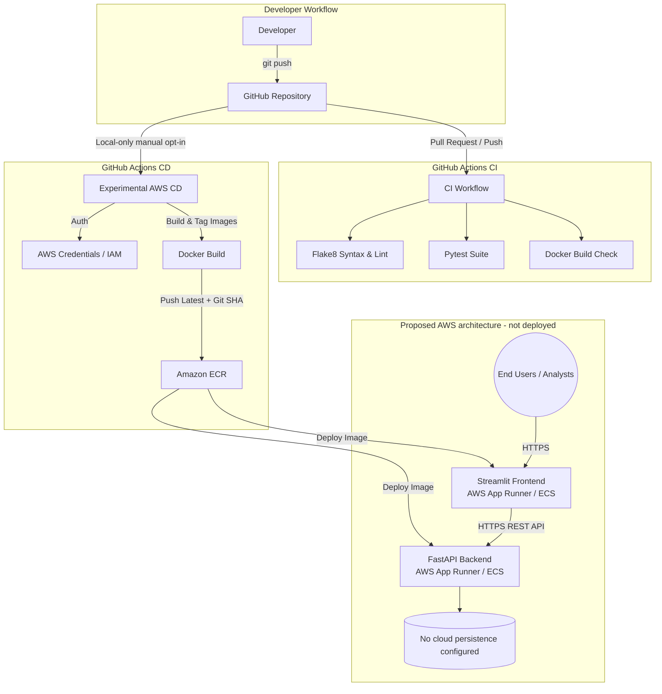

# Deployment Guide (Docker Compose Supported; AWS Postponed)

**Docker Compose is the supported deployment method. AWS is postponed; its local workflow and templates are experimental, Git-ignored, and not included in a public checkout. GCP deployment is not implemented.** Do not create cloud resources or configure AWS secrets for local use.

---

## 1. Architecture Overview



---

## 2. Supported deployment: Docker Compose

Run the FastAPI backend and Streamlit frontend locally with Docker Compose.

### Prerequisites
- Docker Engine & Docker Compose installed.

### 1. Configure Local Environment
Copy `.env.example` to `.env` and replace the placeholder values for `JWT_SECRET_KEY` and `COOKIE_PASSWORD` with strong, unique secrets:
```powershell
Copy-Item .env.example .env
```

### 2. Build and Start the Services
```powershell
docker compose up --build
```

### 3. Verify Health and Accessibility
- **FastAPI Backend**: [http://127.0.0.1:8000](http://127.0.0.1:8000)
- **Backend health**: [http://127.0.0.1:8000/health](http://127.0.0.1:8000/health)
- **Backend API docs**: [http://127.0.0.1:8000/docs](http://127.0.0.1:8000/docs)
- **Streamlit Frontend**: [http://127.0.0.1:8501](http://127.0.0.1:8501)
- **Frontend health**: [http://127.0.0.1:8501/_stcore/health](http://127.0.0.1:8501/_stcore/health)
- **Stop Containers**: `docker compose down`

The Compose file binds ports to loopback and stores backend data/logs in named local Docker volumes. `docker compose down` preserves those volumes; avoid `docker compose down -v` if you need the data. Inside Compose, the frontend reaches the backend at `http://backend:8000`.

---

## 3. AWS (postponed / experimental)

The AWS workflow and templates are retained in the local working tree only; their paths are Git-ignored and they are not included in a public checkout. AWS deployment has not been validated. Do not follow these instructions as a production deployment guide. If this work resumes, replace the workflow's static AWS access-key authentication with GitHub OIDC and least-privilege permissions before use.

### Reference only: Amazon ECR repositories
Run the following AWS CLI commands (or use the AWS Management Console) to create the private container registries:

```bash
# Set your preferred AWS Region
export AWS_REGION="us-east-1"

# 1. Create Backend ECR repository
aws ecr create-repository \
  --repository-name fraud-detection-backend \
  --region $AWS_REGION \
  --image-scanning-configuration scanOnPush=true

# 2. Create Frontend ECR repository
aws ecr create-repository \
  --repository-name fraud-detection-frontend \
  --region $AWS_REGION \
  --image-scanning-configuration scanOnPush=true
```

Save the repository URIs returned (e.g. `123456789012.dkr.ecr.us-east-1.amazonaws.com/fraud-detection-backend`).

---

### Step 2: IAM (future work only)

Do not create an IAM user or access keys for this postponed deployment. Before enabling AWS CD, replace its current long-lived access-key authentication with GitHub OIDC and scope permissions to the selected services and repositories.

The existing example policy below is not validated and must be reviewed before any use.
```json
{
  "Version": "2012-10-17",
  "Statement": [
    {
      "Sid": "ECRAuth",
      "Effect": "Allow",
      "Action": [
        "ecr:GetAuthorizationToken"
      ],
      "Resource": "*"
    },
    {
      "Sid": "ECRPushPull",
      "Effect": "Allow",
      "Action": [
        "ecr:BatchCheckLayerAvailability",
        "ecr:GetDownloadUrlForLayer",
        "ecr:BatchGetImage",
        "ecr:PutImage",
        "ecr:InitiateLayerUpload",
        "ecr:UploadLayerPart",
        "ecr:CompleteLayerUpload",
        "ecr:DescribeRepositories",
        "ecr:DescribeImages"
      ],
      "Resource": [
        "arn:aws:ecr:*:*:repository/fraud-detection-backend",
        "arn:aws:ecr:*:*:repository/fraud-detection-frontend"
      ]
    },
    {
      "Sid": "AppRunnerDeploy",
      "Effect": "Allow",
      "Action": [
        "apprunner:StartDeployment",
        "apprunner:DescribeService"
      ],
      "Resource": "*"
    }
  ]
}
```

Do not generate or add credentials for the current Docker Compose deployment.

---

### Step 3: AWS workflow inputs and secrets (future work only)

No AWS secrets are required for Docker Compose. The local-only experimental workflow references the following repository secrets; do not configure them until the deployment design has been reviewed and the workflow has been migrated to OIDC:

| Secret Name | Description | Example |
|---|---|---|
| `AWS_ACCESS_KEY_ID` | Currently referenced; replace with OIDC before enabling | Not configured |
| `AWS_SECRET_ACCESS_KEY` | Currently referenced; replace with OIDC before enabling | Not configured |
| `AWS_REGION` | Optional region override | Not configured |
| `ECR_BACKEND_REPO` | Optional backend repository-name override | Not configured |
| `ECR_FRONTEND_REPO` | Optional frontend repository-name override | Not configured |
| `APP_RUNNER_BACKEND_ARN` | App Runner backend service ARN | Not configured |
| `APP_RUNNER_FRONTEND_ARN` | App Runner frontend service ARN | Not configured |

---

### Step 4: AWS App Runner reference (not validated)

These notes are not a deployment recipe. The application and cloud configuration have not been tested on App Runner, and the current SQLite/audit paths do not have configured durable cloud storage.

#### 1. Image publishing
The experimental GitHub workflow has no push trigger. A manual run requires selecting `main`, explicitly enabling AWS deployment, and choosing a target. Do not run it until AWS is approved and the workflow has been reviewed.

#### 2. Create the Backend Service in App Runner
1. In the AWS Console, navigate to **AWS App Runner** -> **Create service**.
2. **Source**: Choose **Container registry** -> **Amazon ECR**.
3. **Container image URI**: Select `fraud-detection-backend` with tag `latest`.
4. **Deployment settings**: Use manual deployment if evaluating this reference; automatic deployment has not been validated.
5. **ECR access role**: Allow App Runner to create or use `AppRunnerECRAccessRole`.
6. **Service settings**:
   - Port: `8000`
   - CPU: `1 vCPU`, Memory: `2 GB`
   - **Environment variables**:
     - `PORT`: `8000`
     - `JWT_SECRET_KEY`: `<Your 32+ character secret>`
     - `JWT_EXPIRE_MINUTES`: `60`
     - `ALLOWED_ORIGINS`: the exact frontend origin (never `*` with credentials enabled)
   - **Health check path**: `/health`
7. Click **Create & deploy**. Note down the backend default domain (e.g., `https://xxxxxx.us-east-1.awsapprunner.com`).

#### 3. Create the Frontend Service in App Runner
1. Create another App Runner service using container image `fraud-detection-frontend:latest`.
2. **Service settings**:
   - Port: `8501`
   - CPU: `1 vCPU`, Memory: `2 GB`
   - **Environment variables**:
     - `FRAUD_API_URL`: `<Your Backend App Runner URL from Step 2>` (e.g. `https://xxxxxx.us-east-1.awsapprunner.com`)
     - `COOKIE_PASSWORD`: `<Your 32+ character cookie password>`
     - `STREAMLIT_SERVER_PORT`: `8501`
     - `STREAMLIT_SERVER_ADDRESS`: `0.0.0.0`
   - **Health check path**: `/_stcore/health`
3. Click **Create & deploy**.
4. Do not treat an App Runner service as production-ready without validating persistence, authentication, and network configuration.

---

### Step 5: AWS ECS Fargate reference (not validated)
If your organization standardizes on ECS:
The ECS task-definition templates are local-only and Git-ignored. They are not validated or included in a public checkout. Do not configure cloud secrets or trigger deployment until the templates, permissions, and durable storage are reviewed.

---

## 4. Automated CI/CD Pipelines

### Continuous Integration (`.github/workflows/ci.yml`)
- Triggers on every **Pull Request** and **Push** to `main` / `master`.
- **Jobs**:
  1. `test-and-lint`:
     - Sets up Python 3.11.
     - Runs Flake8 syntax checks.
     - Executes unit test suite (`pytest tests/`) validating health checks, JWT authentication, and preprocessing logic.
     - Publishes test report artifacts.
  2. `docker-build-check`:
     - Builds Docker images for both `backend/` and `frontend/` to ensure zero packaging errors before merging.

### Continuous Deployment (postponed; not included in Git)
The local-only `.github/workflows/cd-aws.yml` is Git-ignored and will not be present in a public checkout. When retained locally, it has no automatic push trigger and requires an explicit manual opt-in on `main`.
- AWS is postponed; the workflow is not deployment-validated and does not wait for a successful CI workflow.
- **Actions**:
  1. Authenticates to AWS using repository access-key secrets (migrate to OIDC before use).
  2. Builds, tags (with Git commit SHA and `latest`), and pushes container images.
  3. Starts App Runner deployment or updates ECS task definitions if the selected workflow target runs.

---

## 5. Security & Production Checklist

- [ ] **Container user**: The current Dockerfiles run as root; non-root execution has not been configured.
- [x] **Local health checks**: Compose checks `/health` for FastAPI and `/_stcore/health` for Streamlit.
- [ ] **Cloud CORS**: Validate an exact allowlist for any future public frontend origin; no cloud origin is configured.
- [x] **Local persistence**: Compose uses named volumes for SQLite data and audit logs. No AWS CloudWatch or EFS integration is configured.
- **Secret strength**: Use unique random local values and never commit `.env`. Compose requires non-empty values; the backend rejects JWT keys shorter than 32 characters, but the frontend does not enforce a `COOKIE_PASSWORD` strength policy.
